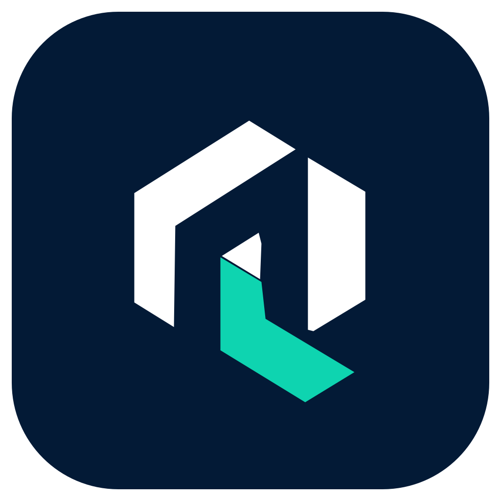
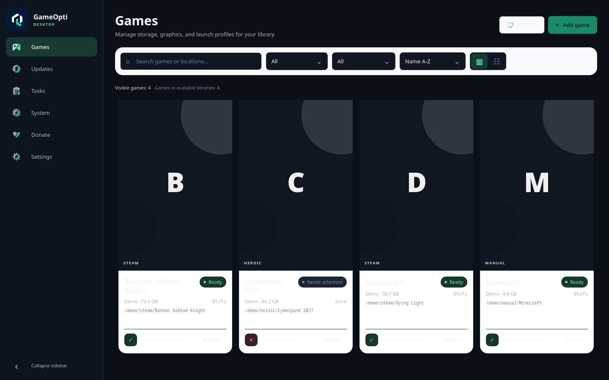
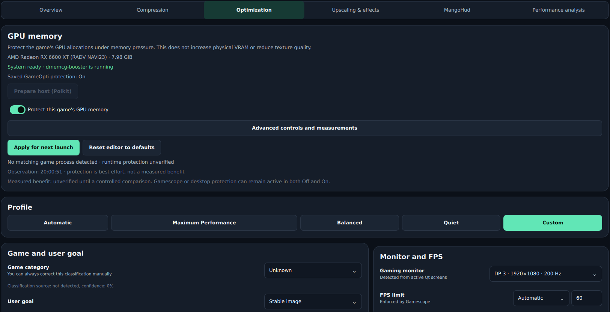
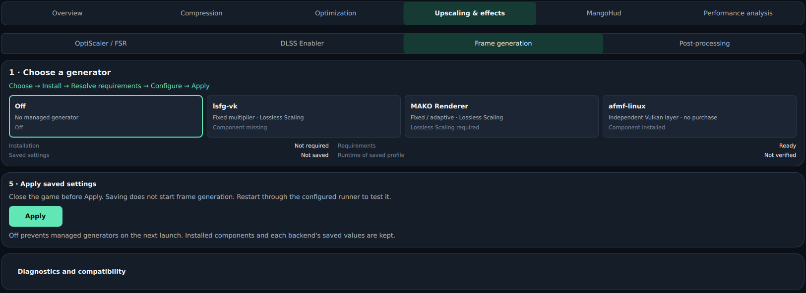
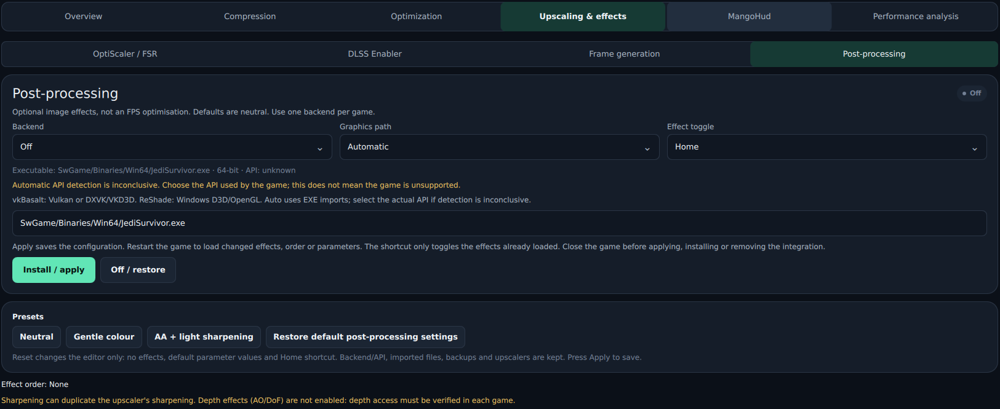
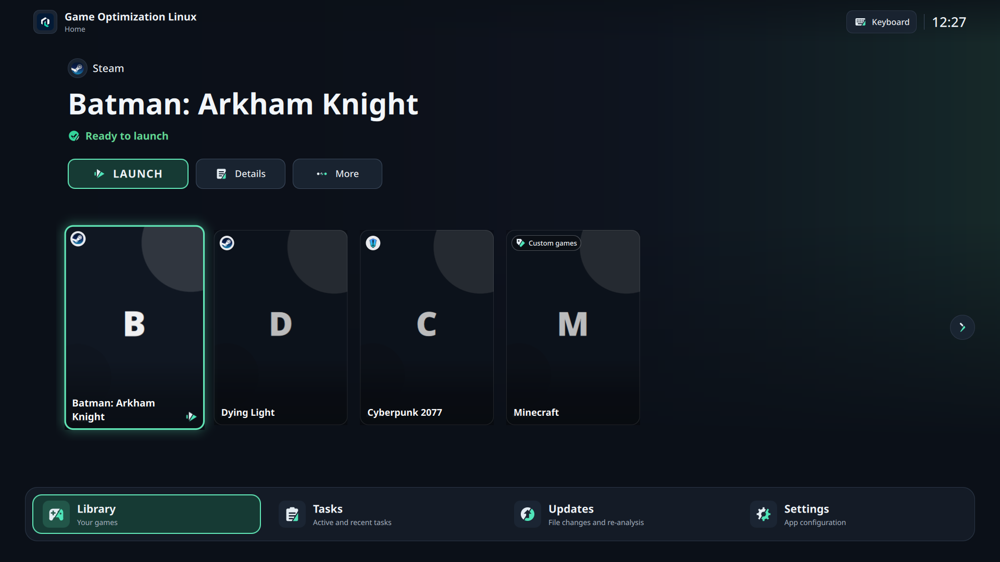

  

<h1 align="center">GameOpti 2.2.0</h1>

  Manage your Linux games, per-game settings, graphics tools and performance measurements. 
  Couch Edition for a controller and TV, Desktop Edition for mouse and keyboard.

  
  
  

  <a href="#features">Features</a> ·
  <a href="#couch-edition-and-desktop-edition">Editions</a> ·
  <a href="#interface">Interface</a> ·
  <a href="#download-and-install">Download</a> ·
  <a href="#documentation">Documentation</a> ·
  <a href="#support-gameopti">Support the project</a>

  

I started GameOpti for my own Linux gaming setup. I wanted one place to manage
my games, their launch settings and the tools I use with them. The project has
grown since then, but that is still the main idea: keep settings per game and
make it easier to see what a change actually does.

GameOpti 2.2.0 Beta is available from GitHub Releases.
The project is still in active development, so compatibility depends on the
game, launcher, hardware, drivers and installed components. Screenshots below
show the current interface; some views use sample data.

Report problems through GitHub Issues.
Project updates and demonstrations are on YouTube.
Features
GameOpti has its own per-game launch handling, performance analysis, Deep
Compression and resource-management features. It also manages several external
graphics and monitoring tools. Those tools keep their own requirements and
compatibility limits.
	What it does
🎮 Game library and launchers	Finds games from Steam, Heroic and Lutris, including native and Flatpak installations. You can also add games manually. Library artwork, source filters and launcher backups are included.
⚙️ Per-game profiles and launching	Keeps launch settings for each game instead of applying the same setup everywhere. GameOpti has its own Steam runner and can apply settings to Heroic and Lutris through their launch configuration. Profiles cover GameMode, display settings, resolution scaling, window modes and FPS limits.
🧠 Smart GPU Scope	Monitors resource pressure during a game session using Linux pressure and cgroup information. When CPU pressure stays high, it can adjust CPU weights for the isolated game and background processes you have opted in to. It tracks its own changes so they can be handled safely afterwards. This is not a custom GPU scheduler and it does not create extra VRAM.
🧩 GPU memory protection	On supported systems, GameOpti uses Linux dmem.low to give a game's GPU-memory allocations priority. This needs compatible kernel, driver and hardware support. It does not add physical VRAM or reduce a game's memory requirements.
🧹 Deep Compression	Analyses a game for files that may not be needed, such as unused language data, language-specific audio, old logs, caches, temporary files and installer leftovers. The analysis checks what can be handled safely; protected or uncertain files are not offered as ordinary cleanup targets. Selected files are moved to quarantine first, so you can test the game and restore them or remove the quarantine afterwards. Deep Compression does not require Btrfs.
💾 Btrfs compression	Uses Btrfs zstd compression for game folders on Btrfs. GameOpti helps compare compression levels, measure storage before and after, track jobs and handle updates. This is separate from Deep Compression: it changes how files are stored, rather than deciding which game files can be removed. A separate deep-recompression operation is available for eligible Btrfs files.
📈 Performance measurements	Lets you record a baseline, test a change and compare the results in the same game and scene. Measurements include FPS, 1% lows, frame times, power and memory where the required data is available. You can keep the change or go back to the previous setup. Results depend on the game and system; GameOpti does not promise an FPS increase for every title.
🖥️ Gamescope and Aqueous	Supports Gamescope and Aqueous as optional compositor choices for runner launches. Their settings are kept separate from the rest of the per-game profile.
✨ Upscaling and FSR	Manages OptiScaler installation, configuration, repair and restoration. Available FSR modes and variants include FSR 4 INT8 Lite and compatible community variants, subject to their own hardware and version requirements.
🧩 DLSS Enabler	Provides a separate per-game backend with configuration and diagnostics. Switching between DLSS Enabler and OptiScaler/Lite is explicit and reversible.
🎞️ Frame generation	Per-game backend selection for Off / lsfg-vk / MAKO Renderer / afmf-linux, with separate settings, on-demand component setup and compatibility checks.
🎨 Post-processing	Manages vkBasalt and ReShade presets, effects, effect order, parameters, shortcuts and per-game restoration.
📊 MangoHud	Per-game configuration with a custom layout, colours, metric selection, placement, preview, FPS limiting and performance logging.
🛠️ Proton tweaks	Per-game compatibility options applied through the launcher that starts the game.
🛋️ Interface	Desktop Mode is available in both editions. Couch Edition also has a full-screen controller interface, controller settings and automatic switching to Couch Mode. Light and dark themes; English, Polish and Spanish translations.

A few requirements are worth checking before using these features:
- Btrfs compression and deep recompression need the game files to be on Btrfs. Deep Compression does not.
- GPU-memory protection requires compatible dmem support from the kernel and hardware/driver stack.
- Gamescope, Aqueous and the graphics backends need their own host or runtime dependencies. Availability can differ between native and Flatpak launchers.
- lsfg-vk and MAKO require a separately purchased copy of Lossless Scaling and compatible files. afmf-linux is an independent project, not AMD's official Linux driver feature.
- Graphics backends can conflict with each other or with individual games. GameOpti checks for known conflicts before applying settings, but it cannot guarantee compatibility with every title. Anti-cheat is not bypassed.
Couch Edition and Desktop Edition
GameOpti 2.2.0 is available as two Flatpak editions. They use the same App ID
and user data, so you can switch editions without losing your profiles. Install
only the edition you plan to use.
	Couch Edition	Desktop Edition
Desktop Mode (mouse and keyboard)	✓	✓
Couch Mode for controller and TV	✓	—
Automatic switch to Couch Mode when a controller is used	✓	—
Controller settings	✓	—
Library, launchers, graphics, storage, MangoHud and measurements	✓	✓

Choose Couch Edition for a living-room or handheld setup. Choose Desktop Edition
if you use a mouse and keyboard and do not need Couch Mode.
Interface
The game pages keep launch settings, Deep Compression, Btrfs tools, graphics
options, MangoHud and performance measurements together. Each section has its
own settings and status, so it is easier to see which component is being used
and what can be restored.
<table>
  <tr>
    <td width="50%" align="center">
      
       <strong>GPU memory & launch profiles</strong>
    </td>
    <td width="50%" align="center">
      
       <strong>Frame generation</strong>
    </td>
  </tr>
  <tr>
    <td width="50%" align="center">
      
       <strong>Post-processing</strong>
    </td>
    <td width="50%" align="center">
      
       <strong>Couch Mode</strong>
    </td>
  </tr>
</table>
Interface previews. Desktop images are cropped from project-owner captures; the
Couch preview uses demo data. [Screenshot notes](docs/screenshots/README.md).
Download and install
GameOpti is distributed through GitHub Releases,
not Flathub. Flathub provides the runtime used by the Flatpak builds.
Flatpak
Add the Flathub remote if it is not already configured:
flatpak remote-add --user --if-not-exists flathub https://dl.flathub.org/repo/flathub.flatpakrepo
Download one of the 2.2.0 bundles from the release page, then install the
edition you chose. The filenames are:
# Couch Edition
flatpak install --user ./Game-Optimization-Linux-2.2.0-couch-edition-x86_64.flatpak

# Desktop Edition
flatpak install --user ./GameOpti-2.2.0-desktop-edition-x86_64.flatpak
Start GameOpti with:
flatpak run io.github.DevVoidPL.GameOptimizationLinux
For Steam profiles, install the user-level host runner:
flatpak run --command=game-optimization-install-runner \
  io.github.DevVoidPL.GameOptimizationLinux
Heroic and Lutris use Apply to launcher and their existing launch
configuration. Tools must be available in the environment that runs the game,
including launcher Flatpaks.

To update, install the newer bundle over the existing one with the reinstall
option. To switch editions, install the other bundle; your application settings
are retained. To remove the Flatpak version, use:
flatpak uninstall --user io.github.DevVoidPL.GameOptimizationLinux
AppImage
The 2.2.0 release also includes an AppImage build. Download it from the release
page, make it executable and run it:
chmod +x ./GameOpti-2.2.0-x86_64.AppImage
./GameOpti-2.2.0-x86_64.AppImage
Future development
GameOpti LXB is a separate project
for controller and TV use, with LineXinBar integration planned. Work on the
main GameOpti application continues alongside it. See the [roadmap](ROADMAP.md)
for current work and later ideas.
Source layout
Path	Contents
src/game_optimization_linux/	Application code, QML interface, translations and artwork.
src/game_optimization_linux/gtk_frontend/	GTK4/libadwaita frontend used by the Desktop Edition.
data/	Desktop entry, AppStream metadata and installation assets.
flatpak/	Build manifests and packaging tools for the Couch and Desktop editions.
libexec/	Helper programs installed with the application.
scripts/	Asset build scripts and the runner installer.
docs/	Feature guides and screenshots.
.github/workflows/	GitHub automation.

Documentation
- [Release status and plans](ROADMAP.md)
- [Architecture and launch flow](docs/architecture.md)
- [Previous release notes: 2.1](docs/release-notes-2.1.md)
- [Build the Flatpak](flatpak/README.md)
For source development, use Python 3.12 or newer:
python -m venv .venv
.venv/bin/python -m pip install -e '.[dev]'
.venv/bin/game-optimization-linux --desktop
Found a problem? Open an issue
with the application version, steps to reproduce it and Copy system info
from GameOpti. Remove personal data from any attached logs or screenshots.
Support GameOpti
GameOpti is free and open source. Donations are optional and help with development and testing.

  
  

Follow Void_Developer_PL on YouTube
for project updates, demonstrations and release news.
Credits and license
Created and maintained by DevVoidPL. Game Optimization Linux is licensed under
MIT.

Some features are GameOpti's own code; others use or manage separate projects.
Thanks to the developers and contributors behind GameMode,
Gamescope, Aqueous,
MangoHud,
OptiScaler,
DLSS Enabler,
vkBasalt, ReShade,
lsfg-vk, MAKO,
afmf-linux,
dmemcg-booster, Wine/Proton,
DXVK, vkd3d-proton, Mesa and the Btrfs/compsize communities. The authors of the
FSR variants and shaders used by the integrations are credited as well.

Third-party tools, game artwork and trademarks remain the property of their
respective authors and retain their own licenses. Proprietary Lossless Scaling
files are not bundled with GameOpti.
