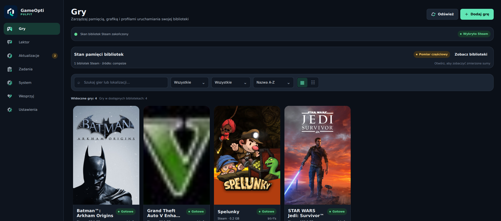
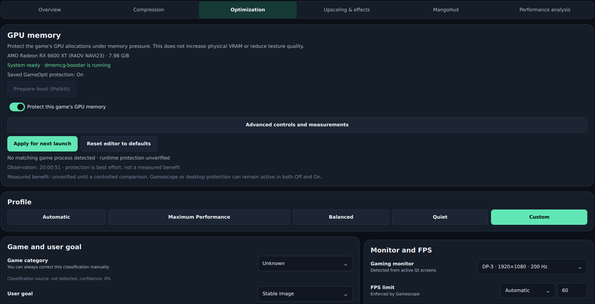
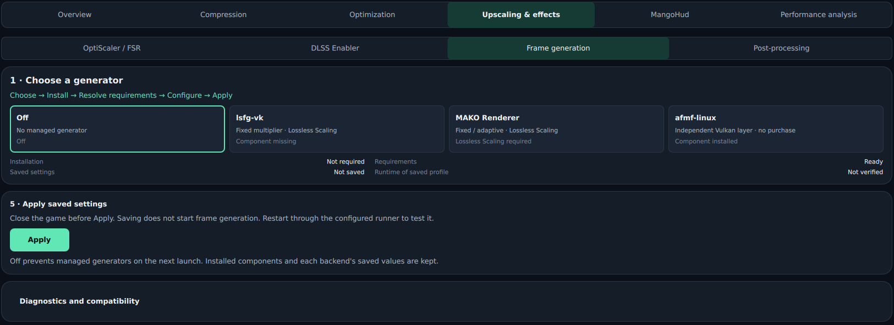
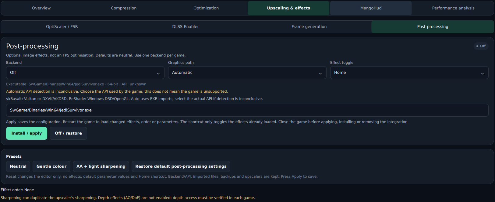
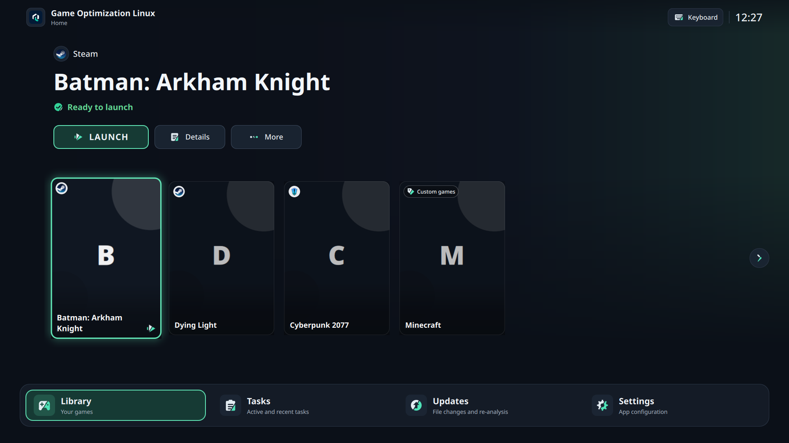

<p align="center">
  
</p>

<h1 align="center">GameOpti 2.1</h1>

<p align="center">
  Manage your Linux game library, graphics, performance and storage from one application.<br>
  Couch Edition for your controller and TV, Desktop Edition for mouse and keyboard.
</p>

<p align="center">
  <a href="ROADMAP.md"></a>
  <a href="https://github.com/DevVoidPL/Game-Optimization-Linux/releases/tag/v2.1.0-Beta"></a>
  <a href="https://www.youtube.com/@Void_Developer_PL"></a>
</p>

<p align="center">
  <a href="#features">Features</a> ·
  <a href="#couch-edition-and-desktop-edition">Editions</a> ·
  <a href="#interface">Interface</a> ·
  <a href="#download-and-install">Download</a> ·
  <a href="#documentation">Documentation</a> ·
  <a href="#support-gameopti">Support the project</a>
</p>

<p align="center">
  
</p>

**GameOpti 2.1 adds an optional RapidOCR engine to the Narrator.** Tesseract stays
the default; download RapidOCR models from the Narrator settings to try it.
Report problems through [GitHub Issues](https://github.com/DevVoidPL/Game-Optimization-Linux/issues).
News and demonstrations are on [YouTube](https://www.youtube.com/@Void_Developer_PL).

## Features

GameOpti brings the tools around your games into one place: choose a game,
configure its profile, apply your changes and launch through its existing launcher.
Keep individual settings for each title rather than changing everything globally.

| | What you can manage |
| --- | --- |
| 🎮 **Library & launchers** | Steam, Heroic, Lutris and manually added games. Native and Flatpak launcher discovery, game artwork, source filters and launcher integration with backup and restore. |
| ⚙️ **Launch profiles** | Automatic, Maximum Performance, Balanced, Low Power, Lowest Latency, Stable Image, Best Quality and Custom. GameMode, Gamescope, display settings, scaling, window modes and FPS limits. |
| 🧠 **GPU-memory protection** | Per-game GPU-memory priority on systems with the required dmem support, host-readiness checks and effective-process diagnostics. Memory-pressure controls follow the detected capabilities. |
| ✨ **Upscaling & FSR** | Managed OptiScaler installation, configuration, repair and restoration. FSR modes and variants include FSR 4 INT8 Lite and compatible community INT8 variants, with separate hardware and version requirements. |
| 🧩 **DLSS Enabler** | A separate per-game backend with configuration and diagnostics, plus explicit, reversible switching from OptiScaler/Lite. |
| 🎞️ **Frame generation** | Choose **Off / lsfg-vk / MAKO Renderer / afmf-linux** per game. On-demand component installation, backend-specific controls, separate saved settings and compatibility checks. |
| 🎨 **Post-processing** | **vkBasalt and ReShade** integration, presets, effect selection and ordering, parameter controls, toggle shortcuts and per-game restoration. Colour, contrast, sharpening and antialiasing in one panel. |
| 📊 **MangoHud** | Per-game presets, metric selection, colours, placement, layout preview, FPS limiting and performance logging. |
| 📈 **Measured optimization** | Record a baseline in the scene you actually play, test one change, compare FPS, 1% lows, frame times, power and memory, then keep or revert it. Results stay local to that game and system, and "keep what you had" is a valid outcome. |
| 💾 **Compression & cleanup** | Btrfs zstd compression, sample-based level selection, before/after storage measurements, update-aware compression and task history. Deep analysis and reversible cleanup quarantine help review reclaimable space. |
| 🎙️ **Narrator / Lektor** | Local subtitle recognition, optional English-to-Polish translation and Polish speech with a built-in voice. Per-game subtitle regions, portal screen capture and support for your own Piper voices. |
| 🛠️ **Tweaks** | Per-game Proton compatibility controls, applied through the launcher that starts the game. |
| 🛋️ **Interface** | Desktop Mode in both editions; full-screen Couch Mode with controller navigation in the Couch Edition. Light/dark themes and English, Polish and Spanish. |

**A few requirements worth knowing:** Btrfs compression needs a Btrfs game folder.
GPU-memory protection depends on kernel, driver and host support; it prioritizes
allocations rather than adding physical VRAM. **lsfg-vk and MAKO require a separately
purchased copy of Lossless Scaling** and their respective compatible files.
**afmf-linux is an independent project**, not AMD's official Linux driver feature.
Graphics backends have different API, runtime and loader requirements, so GameOpti
checks conflicts before applying them. Anti-cheat is never bypassed.

## Couch Edition and Desktop Edition

GameOpti 2.1 comes as two alternative Flatpak bundles of the same application.
Install one of them; both use the same App ID and the same settings, so you can switch
by installing the other bundle without losing your profiles.

| | Couch Edition | Desktop Edition |
| --- | --- | --- |
| Desktop Mode (mouse and keyboard) | ✓ | ✓ |
| Couch Mode for controller and TV | ✓ | — |
| Automatic switch to Couch Mode when a controller is used | ✓ | — |
| Controller settings | ✓ | — |
| Library, launchers, graphics, storage, MangoHud, Narrator, measurements | ✓ | ✓ |

Choose the **Couch Edition** for a living-room or handheld setup, and the
**Desktop Edition** if you only use a mouse and keyboard.

## Interface

Focused per-game pages keep compression, optimization, upscaling, effects,
MangoHud and performance analysis within easy reach. Component installation,
saved settings and runtime status are presented separately. Backups and restore
actions stay alongside the integrations they belong to.

<table>
  <tr>
    <td width="50%" align="center">
      
      <br><strong>GPU memory & launch profiles</strong>
    </td>
    <td width="50%" align="center">
      
      <br><strong>Frame generation</strong>
    </td>
  </tr>
  <tr>
    <td width="50%" align="center">
      
      <br><strong>Post-processing</strong>
    </td>
    <td width="50%" align="center">
      
      <br><strong>Couch Mode</strong>
    </td>
  </tr>
</table>

*Development interface previews. Desktop images are cropped from project-owner
captures; the Couch preview uses demo data. [Screenshot notes](docs/screenshots/README.md).*

## Download and install

The current release is
[**Game Optimization Linux 2.1**](https://github.com/DevVoidPL/Game-Optimization-Linux/releases/tag/v2.1.0-Beta) (Beta).
Download one of its x86_64 Flatpak bundles:

- [Couch Edition](https://github.com/DevVoidPL/Game-Optimization-Linux/releases/download/v2.1.0-Beta/Game-Optimization-Linux-2.1.0-couch-edition-x86_64.flatpak) – Desktop Mode and Couch Mode
- [Desktop Edition](https://github.com/DevVoidPL/Game-Optimization-Linux/releases/download/v2.1.0-Beta/Game-Optimization-Linux-2.1.0-desktop-edition-x86_64.flatpak) – Desktop Mode only

GameOpti is distributed through GitHub Releases, not Flathub; Flathub supplies its runtime.

```bash
flatpak remote-add --user --if-not-exists flathub https://dl.flathub.org/repo/flathub.flatpakrepo
flatpak install --user ./Game-Optimization-Linux-2.1.0-couch-edition-x86_64.flatpak
flatpak run io.github.DevVoidPL.GameOptimizationLinux
```

For Steam profiles, install the user-level host runner:

```bash
flatpak run --command=game-optimization-install-runner \
  io.github.DevVoidPL.GameOptimizationLinux
```

GameOpti provides the runner setup instructions for Steam. Heroic and Lutris use
**Apply to launcher** and their existing launch configuration. Tools must be
available in the environment that runs the game, including launcher Flatpaks.

To update or switch edition, download the bundle and install it with
`flatpak install --user --reinstall ./Game-Optimization-Linux-*.flatpak`.
Application settings are retained. To remove the application, use
`flatpak uninstall --user io.github.DevVoidPL.GameOptimizationLinux`.

## Future development

**GameOpti LXB** is in development as a separate controller and TV application,
intended to work with LineXinBar. Longer-term **Beta 3.0** research covers AI Graphics
Remaster, Smart GPU Scope and deeper game and engine recognition. These are research
directions: support will start with specific games and setups, and there is no release date yet.

## Source layout

| Path | Contents |
| --- | --- |
| `src/game_optimization_linux/` | Application code, QML interface, translations and artwork. |
| `data/` | Desktop entry, AppStream metadata and installation assets. |
| `flatpak/` | Build manifests for the Couch and Desktop editions. |
| `libexec/` | Helper programs installed with the application. |
| `scripts/` | Build, translation and asset maintenance scripts. |
| `tests/` | Automated tests and interface checks. |
| `tools/` | Development utilities. |
| `docs/` | Feature guides and screenshots. |
| `.github/workflows/` | GitHub automation. |

## Documentation

- [Release status and plans](ROADMAP.md)
- [Testing and contributing](TESTING.md)
- [Architecture and launch flow](docs/architecture.md)
- [Btrfs compression measurements](docs/compression_validation.md)
- [Narrator components and licenses](docs/narrator-components.md)
- [Release notes 2.1](docs/release-notes-2.1.md)
- [RapidOCR setup and limits](docs/narrator-rapidocr.md)
- [Build the Flatpak](flatpak/README.md)

For source development, use Python 3.12+:

```bash
python -m venv .venv
.venv/bin/python -m pip install -e '.[dev]'
.venv/bin/game-optimization-linux --desktop
```

Found a problem? [Open an issue](https://github.com/DevVoidPL/Game-Optimization-Linux/issues)
with the application version, reproduction steps and **Copy system info** from
GameOpti. Remove personal data from any attached logs or screenshots.

## Support GameOpti

GameOpti is free and open source. Optional donations help fund development and testing.

<p align="center">
  <a href="https://buymeacoffee.com/voiddeveloperpl"></a>
  <a href="https://www.paypal.com/paypalme/GameOptimation"></a>
</p>

Follow **[Void_Developer_PL on YouTube](https://www.youtube.com/@Void_Developer_PL)**
for project updates, demonstrations and release news.

## Credits and license

Created and maintained by **DevVoidPL**. Game Optimization Linux is licensed under
[MIT](LICENSE).

GameOpti builds on the work of [GameMode](https://github.com/FeralInteractive/gamemode),
[Gamescope](https://github.com/ValveSoftware/gamescope),
[MangoHud](https://github.com/flightlessmango/MangoHud),
[OptiScaler](https://github.com/optiscaler/OptiScaler),
[DLSS Enabler](https://github.com/artur-graniszewski/DLSS-Enabler),
[vkBasalt](https://github.com/DadSchoorse/vkBasalt), [ReShade](https://reshade.me/),
[lsfg-vk](https://lsfg-vk.dev/), [MAKO](https://github.com/eugeniosegala/MAKO),
[afmf-linux](https://github.com/serialexperimentslainnnn/afmf-linux),
[dmemcg-booster](https://gitlab.steamos.cloud/holo/dmemcg-booster) and their contributors.
Thanks also to the Wine/Proton, DXVK, vkd3d-proton, Mesa, Btrfs/compsize,
PipeWire, Tesseract, CTranslate2, OPUS-MT/Argos and Piper communities,
and the authors of the FSR variants and shaders used by the integrations.

Third-party tools, models, game artwork and trademarks remain the property of
their respective authors and retain their own licenses. Proprietary Lossless
Scaling files are not bundled with GameOpti. The bundled **Voidek** voice model is
© DevVoidPL and has [its own license](flatpak/bundled/VOIDEK-LICENSE.md); it is not
covered by the MIT license.
